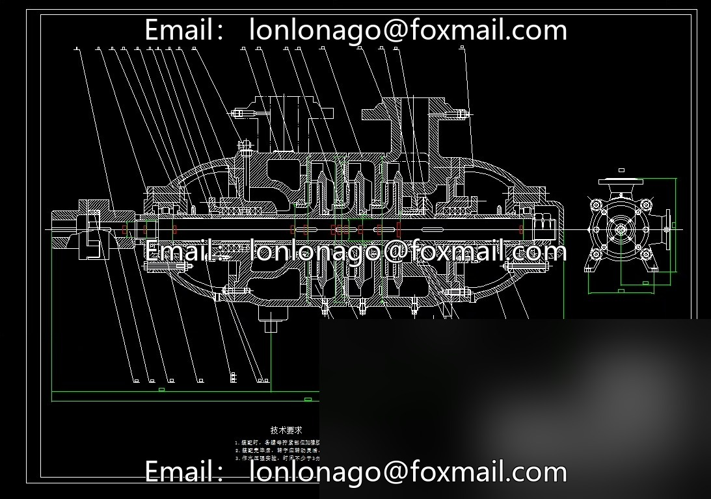
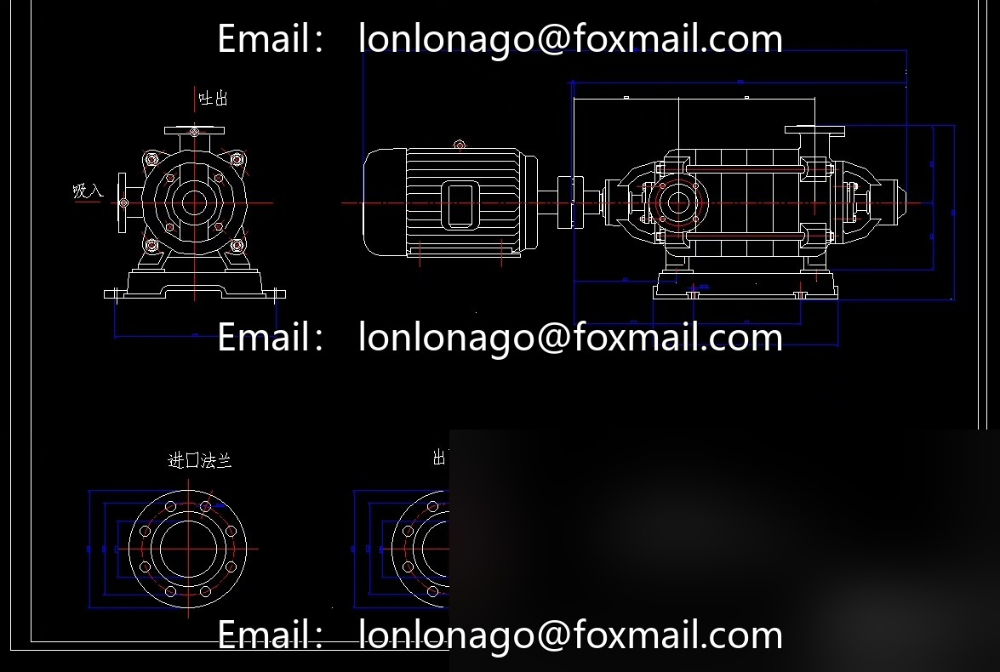
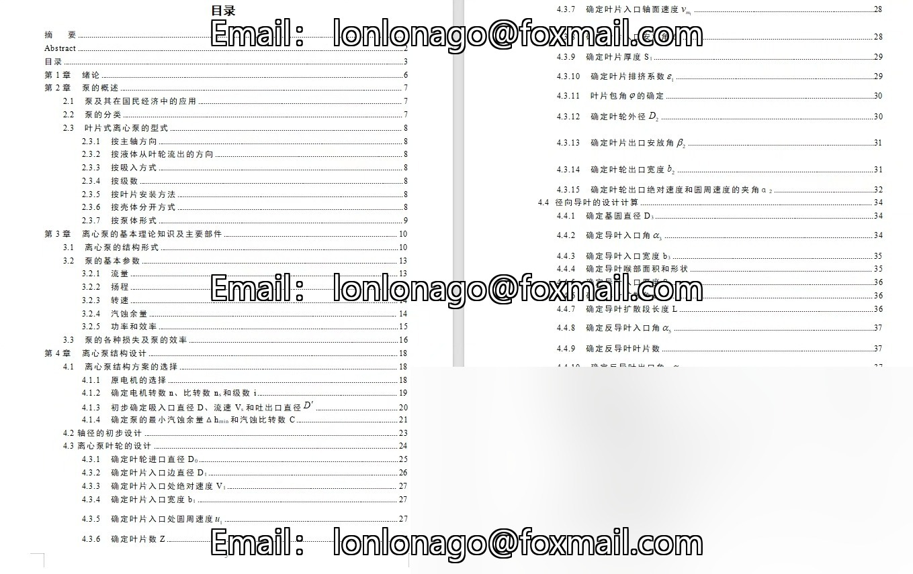

# Multisegment centrifugal pump structural design centrifugal pump structural design multi-segment centrifugal pump joint

## Body

Multi-stage centrifugal pump structural design; centrifugal pump structural design; multi-stage centrifugal pump structural design diagram; design CAD drawing of multi-stage centrifugal pump structure
466 This material is a design of a 200D multi-stage centrifugal pump structure, including a manual and CAD drawing

The document provides multi-stage centrifugal pump design, featuring CAD drawings, instructions and technical requirements covering various calculations.

<!-- AI_ENRICHED -->

## Images

## Payment

Here is a pay link on Stripe ( https://buy.stripe.com/3cs8yP7sY87d0vu9AB ). Please contact me lonlonago@foxmail.com after funding $89, and I will send you a complete data files , thank you!

